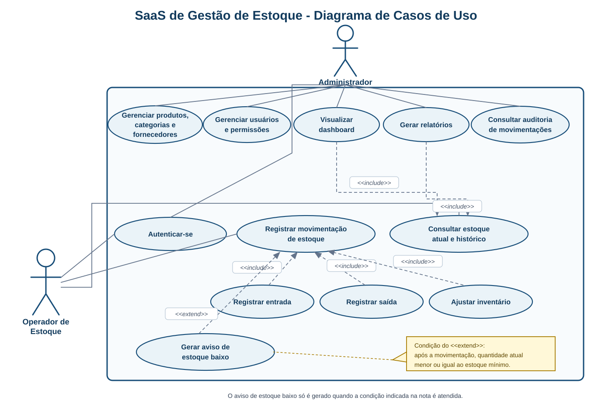
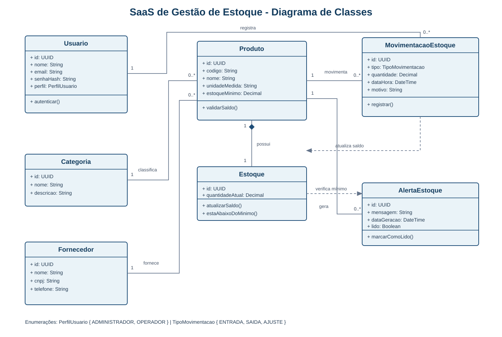

# SaaS de Gestão de Estoque

## Diagrama UML - Casos de Uso

**Contexto do projeto:** o armazém parceiro ainda acompanha o estoque de forma informal. A proposta do grupo é criar um sistema on-line para registrar produtos, entradas e saídas, consultar o saldo disponível e reduzir erros na reposição de mercadorias.

> A versão editável está em [diagrama-casos-de-uso.puml](diagrama-casos-de-uso.puml). Ela pode ser aberta e exportada em PNG ou PDF pelo PlantUML.

## Diagrama UML - Classes

> A versão editável está em [diagrama-classes.puml](diagrama-classes.puml). Esse diagrama complementa os casos de uso, pois mostra como os dados do sistema se relacionam.

### O que o diagrama de classes representa

O diagrama mostra a estrutura básica dos dados do sistema. `Produto` é a classe central: pertence a uma `Categoria`, é associado a um `Fornecedor` e possui um registro de `Estoque`. Cada `MovimentacaoEstoque` registra uma entrada, saída ou ajuste e informa qual `Usuario` realizou a operação. Se a quantidade ficar abaixo do estoque mínimo, o sistema poderá gerar um `AlertaEstoque`.

As enumerações `PerfilUsuario` e `TipoMovimentacao` restringem os valores possíveis para perfis de acesso e tipos de operação, mantendo os registros consistentes.

## O que o diagrama representa

Este é um **diagrama de casos de uso UML**. Ele indica quem utiliza o sistema e quais tarefas cada perfil poderá realizar.

| Ator | Papel no sistema |
|---|---|
| Administrador | Configura o sistema, gerencia cadastros e permissões, acompanha relatórios e consulta os dados gerais do armazém. |
| Operador de Estoque | Atua na rotina do estoque: registra entradas, saídas e ajustes e consulta o saldo dos produtos. |

As setas `<<include>>` indicam que uma ação depende de outra. Por exemplo, uma entrada, saída ou ajuste altera o saldo do estoque. A relação `<<extend>>` representa uma ação que ocorre em uma condição específica, como o aviso de estoque baixo.

## Funcionalidades previstas

### 1. Acesso e segurança

- Login para identificar o usuário que acessa o sistema.
- Perfis e permissões para definir quem pode consultar, cadastrar ou alterar informações.
- Histórico das movimentações com usuário, data, tipo de operação e quantidade.

### 2. Cadastros básicos

- Produtos com nome, código, unidade de medida, quantidade atual e estoque mínimo.
- Categorias, como detergentes, desinfetantes, papéis e itens de higiene.
- Fornecedores para apoiar o processo de compra e reposição.

### 3. Controle de estoque

- Registro de **entradas** de mercadorias recebidas.
- Registro de **saídas** por venda, consumo, perda ou devolução.
- Ajuste de inventário quando a quantidade física for diferente da quantidade registrada.
- Consulta do saldo atual e do histórico de cada produto.

### 4. Gestão e tomada de decisão

- Dashboard com quantidade total de itens, produtos com estoque baixo, últimas movimentações e itens mais movimentados.
- Avisos automáticos quando um produto atingir ou ficar abaixo do estoque mínimo.
- Relatórios de estoque atual, entradas e saídas por período, produtos com baixo estoque e histórico de movimentações.

## Regras de negócio iniciais

1. Cada produto deve possuir um código único e uma unidade de medida.
2. Toda entrada, saída ou ajuste deve gerar um registro no histórico.
3. Uma saída não deve deixar o estoque negativo sem autorização do administrador.
4. O sistema deve comparar a quantidade atual com o estoque mínimo e sinalizar a necessidade de reposição.
5. Apenas usuários autorizados podem alterar usuários, permissões e configurações gerais.

## Melhorias para etapas futuras

- Leitura de código de barras ou QR Code.
- Importação e exportação de planilhas.
- Cadastro de clientes e pedidos, caso o armazém também registre vendas.
- Previsão de reposição baseada no histórico de consumo ou vendas.
- Notificações por e-mail ou WhatsApp para estoque baixo.
- Controle de múltiplos depósitos/filiais e inventário por localização.

## Resumo para apresentar ao professor

O projeto pretende substituir o controle informal do armazém por um sistema de estoque mais organizado. Nele, será possível cadastrar produtos e fornecedores, registrar entradas e saídas e acompanhar o saldo em tempo real. Os relatórios, o dashboard e os avisos de estoque baixo ajudarão a empresa a identificar o que precisa ser reposto e a reduzir falhas na rotina.
